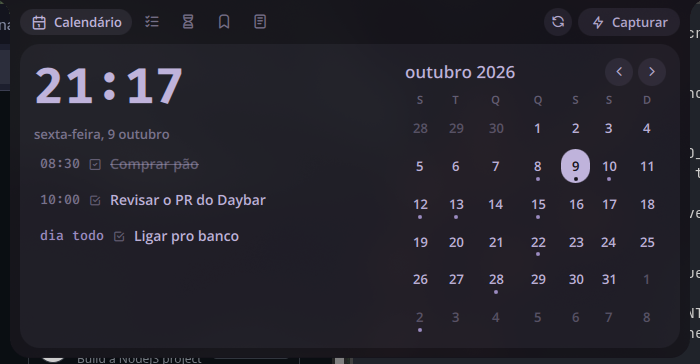
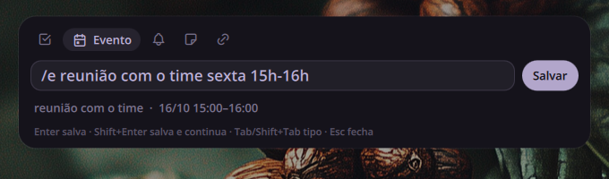
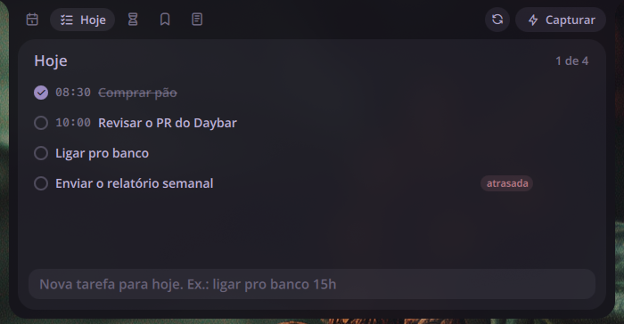
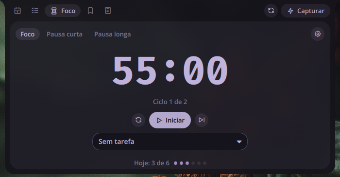
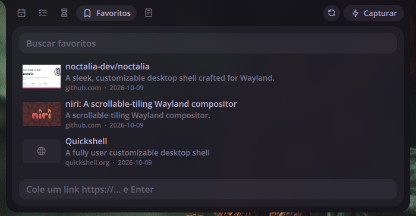
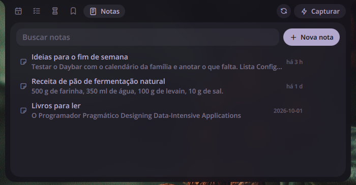
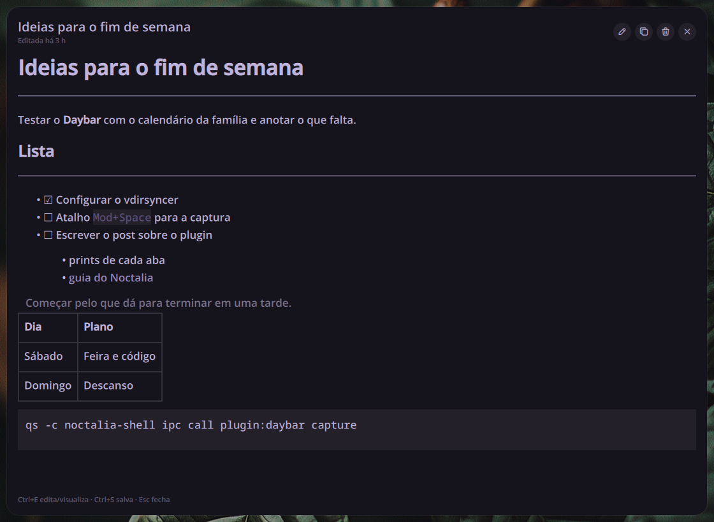

# Daybar

A [Noctalia Shell](https://github.com/noctalia-dev/noctalia) plugin for the day:
a centered quick-capture field and a bar toolbar with Calendar (Google Calendar),
Today, Focus (pomodoro), Bookmarks and Notes.

> [!IMPORTANT]
> Daybar is a **Noctalia Shell v4** plugin (QML, `manifest.json`), tested on
> **noctalia-shell 4.7.7**. It does **not** run on Noctalia v5, whose plugin system
> is a different one (Luau scripts with a `plugin.toml` manifest). A v5 port is
> planned. See [Compatibility](#compatibility).

| Today | Focus |
|-------|-------|
|  |  |
| **Bookmarks** | **Notes** |
|  |  |

More in [screenshots/](screenshots/): every capture type and the note window.

## Capture

Open it with a shortcut (see [niri binding](#shortcuts)) and type:

| You type | It becomes |
|----------|------------|
| `comprar pão amanhã 9h` | task for tomorrow 09:00 (no date = today) |
| `/e reunião sexta 15h-16h` | Google Calendar event (1h when there is no end) |
| `/l pagar boleto 18h` | reminder: 15-minute event with alarm + local toast |
| `/n uma ideia` | note, listed in Notes |
| `/t 10m chá` | timer: countdown with alarm (`/t` pauses or resumes, `/t parar` resets) |
| `/p`, `/p foco`, `/p curta`, `/p longa`, `/p parar` | pomodoro: start/pause, switch phase and start, reset |
| `https://...` | bookmark with page preview (prefilled from the clipboard) |
| `=200*15%` | calculation; Enter copies the result |

`Tab` cycles the type, `Enter` saves and closes, `Shift+Enter` saves and keeps the
field open, `Esc` closes.

## Focus

The Focus tab runs pomodoro phases (Focus, Short break, Long break) and a Timer,
each with its clock inside a progress ring. The Timer takes any duration: `90s`,
`10m`, `1h30`, `1h 30m`, `1:30` (1 min 30 s) or a bare number of minutes, up to
24 h, plus an optional label (`10m chá`). Presets start 1, 5, 10, 15 or 30 minutes
at once. When it ends it plays the same alarm as the pomodoro and shows a toast
with the label. Only one clock counts at a time: starting the timer pauses a
running pomodoro and starting the pomodoro pauses the timer, both keeping their
remaining time. The bar shows whichever clock is running.

### Detached clock

Two buttons in the Focus header take the clock out of the panel, each with one
click (click again to close):

- **Open in a window** opens a normal Niri window titled *Daybar timer*, which you
  can move, resize or send to another monitor. The ring and numbers scale with it.
- **Pin to corner** pins a small clock to a screen corner, above windows (full-screen
  apps cover it), on every workspace, without taking keyboard focus. Settings >
  *Pinned clock corner* and *Pinned clock size* (small, medium, large) move and
  resize it.

Both show the running or ringing clock, else the one selected in the Focus tab:
just the ring and the numbers. Hover to get play/pause and reset (and close, on the
pinned clock). Both reopen after a shell restart.

The window opens tiled unless niri is told otherwise. To float it in the top-right
corner (`~/.config/niri/config.kdl`):

~~~kdl
window-rule {
    match app-id="^dev\.noctalia\.noctalia-qs$" title="^Daybar timer$"
    open-floating true
    default-column-width { fixed 280; }
    default-window-height { fixed 280; }
    default-floating-position x=24 y=24 relative-to="top-right"
}
~~~

## Bookmarks

The Bookmarks tab lists saved links with a thumbnail, title, description and
domain. Pasting an https URL and pressing Enter saves the row at once. The page
preview is fetched once and the thumbnail is cached under
`~/.cache/noctalia-daybar/thumbs/`. Saving the same URL again replaces the row
and refetches it. Search ignores accents. Hover the row to copy, refresh, rename
or delete; delete asks first. With "Fetch link previews" off, the row keeps the
domain and nothing is downloaded.

## Notes

The Notes tab lists notes newest-edit first, with a derived title, a one-line
snippet and a relative time.

Opening one shows a centered overlay: Markdown
preview by default, a plain-text editor after Ctrl+E. The text is saved about
600 ms after the last keystroke, and at once with Ctrl+S. Esc closes. A new note
closed while still empty is not stored. Remote images are shown as links.

## Compatibility

| Noctalia | Status |
|----------|--------|
| v4 (`noctalia-shell` 4.7.x, run as `qs -c noctalia-shell`) | Supported, tested on 4.7.7 |
| v4 before 4.7 | Untested |
| v5 (`noctalia` 5.x) | Not supported: v5 plugins are written in Luau, so Daybar would need a rewrite |

**v5 is planned.** I intend to port Daybar to Noctalia v5 once I have it installed
and tested on my CachyOS setup. Until then, v4 is the only supported target.

On Arch/CachyOS the v4 shell is the `noctalia-shell` package and v5 is `noctalia`;
both can be installed side by side. Check the installed v4 version with
`pacman -Q noctalia-shell`, and make sure the bar you use is started with
`qs -c noctalia-shell`.

## Requirements

- noctalia-shell 4.7.x (see [Compatibility](#compatibility))
- `khal`, `vdirsyncer`, `wl-clipboard`, `xdg-utils`

~~~bash
sudo pacman -S --needed khal vdirsyncer python-aiohttp-oauthlib wl-clipboard xdg-utils libsecret
~~~

## Install

~~~bash
git clone https://github.com/nandomoreirame/noctalia-daybar ~/dev/projects/noctalia-daybar
ln -s ~/dev/projects/noctalia-daybar ~/.config/noctalia/plugins/daybar
~~~

Enable **Daybar** in Noctalia Settings > Plugins, then add the **Daybar** widget to
the bar. Disable the standalone pomodoro plugin if you used it.

## Google Calendar setup (one time)

Daybar reads events through Noctalia's calendar service (khal provider) and writes
with `khal new`. vdirsyncer keeps khal and Google in sync.

Events can be deleted from the panel. Read-only calendars are excluded.

1. **OAuth client.** In Google Cloud Console create a project, enable the
   **CalDAV API**, configure the OAuth consent screen as *External* and **publish it
   ("In production")**. In *Testing* status Google expires the refresh token every
   7 days. Create an OAuth client of type *Desktop app*.
2. **Store the secrets** in the keyring:

   ~~~bash
   secret-tool store --label="vdirsyncer google id" service vdirsyncer-google key client_id
   secret-tool store --label="vdirsyncer google secret" service vdirsyncer-google key client_secret
   ~~~

3. **vdirsyncer** (`~/.config/vdirsyncer/config`):

   ~~~ini
   [general]
   status_path = "~/.local/share/vdirsyncer/status/"

   [pair google_calendar]
   a = "google_calendar_remote"
   b = "google_calendar_local"
   collections = ["from a", "from b"]
   conflict_resolution = "a wins"

   [storage google_calendar_remote]
   type = "google_calendar"
   token_file = "~/.local/share/vdirsyncer/google_token"
   client_id.fetch = ["command", "secret-tool", "lookup", "service", "vdirsyncer-google", "key", "client_id"]
   client_secret.fetch = ["command", "secret-tool", "lookup", "service", "vdirsyncer-google", "key", "client_secret"]

   [storage google_calendar_local]
   type = "filesystem"
   path = "~/.local/share/calendars/google/"
   fileext = ".ics"
   ~~~

   Then authorize and sync (opens the browser once):

   ~~~bash
   vdirsyncer discover google_calendar && vdirsyncer metasync && vdirsyncer sync
   ~~~

4. **khal** (`~/.config/khal/config`). Daybar passes ISO dates, so the locale
   formats must be ISO:

   ~~~ini
   [calendars]
   [[google]]
   path = ~/.local/share/calendars/google/*
   type = discover

   [locale]
   timeformat = %H:%M
   dateformat = %Y-%m-%d
   longdateformat = %Y-%m-%d
   datetimeformat = %Y-%m-%d %H:%M
   longdatetimeformat = %Y-%m-%d %H:%M
   firstweekday = 0
   ~~~

   Check with `khal printcalendars` and pick the default calendar in Daybar's settings.
5. **Periodic sync** (`~/.config/systemd/user/vdirsyncer.service` and `.timer`):

   ~~~ini
   # vdirsyncer.service
   [Unit]
   Description=Synchronize calendars

   [Service]
   Type=oneshot
   ExecStart=/usr/bin/vdirsyncer sync
   ~~~

   ~~~ini
   # vdirsyncer.timer
   [Unit]
   Description=Synchronize calendars every 10 minutes

   [Timer]
   OnBootSec=2m
   OnUnitActiveSec=10m

   [Install]
   WantedBy=timers.target
   ~~~

   ~~~bash
   systemctl --user daemon-reload && systemctl --user enable --now vdirsyncer.timer
   ~~~

6. In Noctalia Settings > Location keep **Show calendar events** on.

Without khal the Calendar tab shows "Calendar not configured"; tasks, notes, bookmarks,
calculations and the focus timer keep working.

## Shortcuts

IPC target `plugin:daybar`:

~~~bash
qs -c noctalia-shell ipc call plugin:daybar capture      # quick capture
qs -c noctalia-shell ipc call plugin:daybar toggle       # toolbar
qs -c noctalia-shell ipc call plugin:daybar open today   # calendar | today | focus | bookmarks | notes
~~~

niri (`~/.config/niri/config.kdl`):

~~~kdl
binds {
    Mod+Space       hotkey-overlay-title="Daybar: capture" { spawn "qs" "-c" "noctalia-shell" "ipc" "call" "plugin:daybar" "capture"; }
    Mod+Shift+Space hotkey-overlay-title="Daybar: toolbar" { spawn "qs" "-c" "noctalia-shell" "ipc" "call" "plugin:daybar" "toggle"; }
}
~~~

## Focus mode hook

Settings > *Focus mode command* runs an executable with `on` when a focus session
starts and `off` when it stops (pause, break, finish). Leave it empty to disable.

## Data

`~/.local/share/noctalia-daybar/data.json` (tasks, event checks, reminders,
bookmarks, notes). Bookmark thumbnails live in
`~/.cache/noctalia-daybar/thumbs/`. A corrupt file is kept as `data.json.bak`
and a fresh one is started.

## Development

~~~bash
npm install
npm test
~~~

Logic lives in `utils/**/*.js` (QML JavaScript libraries, tested with vitest through
a transform in `vitest.config.js`); QML files are thin UI. Manual checks:
[docs/SMOKE.md](docs/SMOKE.md).

## License

MIT. The focus timer is derived from an MIT plugin, see [THIRD_PARTY.md](THIRD_PARTY.md).
